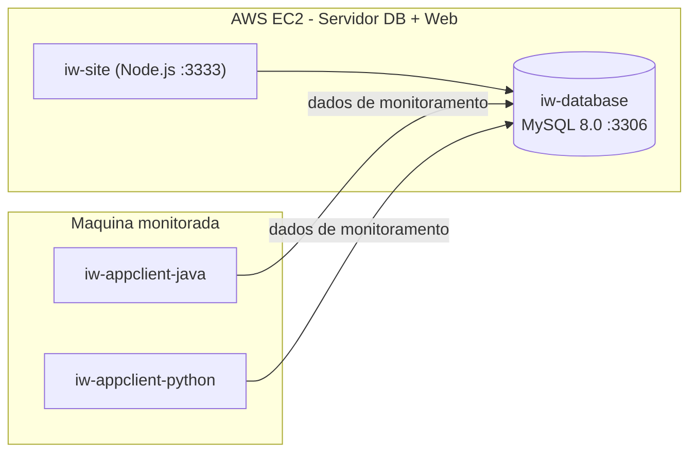

# InfraWatch

Plataforma de **monitoramento de hardware** de servidores de FDPS (Flight Data
Processing System). Agentes em Java e Python rodam em segundo plano nas máquinas
monitoradas e gravam as leituras em um banco MySQL central; uma aplicação web lê
esse banco e mostra dashboards por máquina e componente (CPU, RAM, disco, rede e
sistema), com alertas.

Projeto acadêmico do 2º semestre do curso de Sistemas de Informação da São Paulo
Tech School (SPTech), em 2025.

## Arquitetura



O ambiente tem dois tipos de máquina Ubuntu, cada uma com seu script de setup em
`iw-infra`:

- **Servidor (AWS EC2):** sobe o banco MySQL 8.0 (porta 3306) e a aplicação web
  Node.js (porta 3333) via Docker Compose (`setup_db_web.sh`).
- **Máquina monitorada:** roda os agentes Java e Python em segundo plano, que
  enviam os dados de monitoramento ao banco (`setup_client.sh`).

## Repositórios públicos

| Repositório | O que é | Stack |
|---|---|---|
| [iw-infra](https://github.com/Infra-Watch/iw-infra) | Infraestrutura: Dockerfiles, Docker Compose e scripts de provisionamento do servidor (DB + web) e das máquinas monitoradas, em AWS EC2 | Shell, Docker, Docker Compose |
| [iw-appweb](https://github.com/Infra-Watch/iw-appweb) | Aplicação web: frontend em `public/` e API em `src/` (porta 3333) | JavaScript, Node.js |
| [iw-database](https://github.com/Infra-Watch/iw-database) | Banco de dados: scripts SQL de criação de tabelas e dados de exemplo | MySQL 8.0 |
| [iw-appclient-java](https://github.com/Infra-Watch/iw-appclient-java) | Agente de coleta em Java, executado como `.jar` na máquina monitorada | Java (OpenJDK 21) |
| [iw-appclient-python](https://github.com/Infra-Watch/iw-appclient-python) | Agente de coleta em Python, executado em virtualenv na máquina monitorada | Python |

## Como rodar o sistema

O provisionamento fica no repositório
[iw-infra](https://github.com/Infra-Watch/iw-infra).

**Servidor (banco + web) em uma instância AWS EC2 com Ubuntu**, conectado como
`ubuntu`:

```bash
cd /home/ubuntu
git clone https://github.com/Infra-Watch/iw-infra.git
cd iw-infra
sudo bash setup_db_web.sh
```

Depois da execução, o site fica em `:3333` e o MySQL em `:3306`. O Security Group
da instância precisa liberar as portas usadas (22, 3333 e, se acessado de fora,
3306).

**Máquina monitorada:**

```bash
git clone https://github.com/Infra-Watch/iw-infra.git
cd iw-infra
sudo bash setup_client.sh
```

O passo a passo completo, incluindo a geração das imagens Docker, está no
[README do iw-infra](https://github.com/Infra-Watch/iw-infra).

## Equipe

| Integrante | Papel | GitHub |
|---|---|---|
| Bryan Anthony | Front-end | [@Bryan-Anthony](https://github.com/Bryan-Anthony) |
| Bryan Machado | Infraestrutura/DevOps e Front-end | [@bmsis77](https://github.com/bmsis77) |
| Daniela Carvalho | Back-end (agente Java) e Análise de Dados | [@dan1gomes](https://github.com/dan1gomes) |
| Davi Domingues | Banco de Dados, Back-end (API Node), Análise de Dados e Infraestrutura/DevOps | [@davi-domingues](https://github.com/davi-domingues) |
| Maria Luiza Costa Goes | Front-end | [@MariaLuizaCostaGoes](https://github.com/MariaLuizaCostaGoes) |
